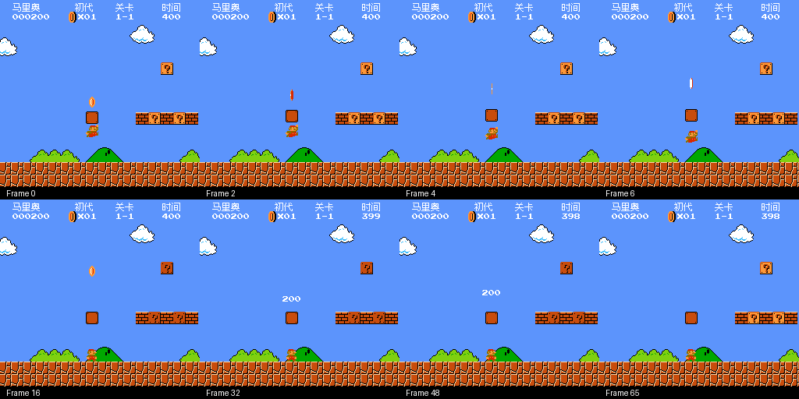

# 金币特效、中文界面与日版二代 32 关

日期：2026-10-17。工程：`D:/Unity/project/超级马里奥`。Unity 6000.3.15f1，Windows x64。

## 修复与新增

- 顶金币砖原先只调用计分函数，没有创建动画对象。现生成独立 `CoinPop`：旋转、上升、落回，转为浮动“200”，最终清理。它不参加道具/敌人碰撞，不再次增加金币或分数。
- HUD 原先只绘制 `X数量`。现显式绘制金币图标，并显示当前是初代还是二代。
- 实际画面检查发现旧参考库的弹出金币包含粉色帧。已从原版 CHR `$60–$63` 重建 8×16 四帧金色金币，普通场景金币采用调色循环。
- 原字体只有 42 个 ASCII 字形，没有中文。保留原版 8×8 数字/拉丁字母，补充 Fusion Pixel 12px 简体中文像素字体。当前界面与世界内提示所需的 **93 个汉字全部通过 cmap、字形资源与非空图像检查**。源字体与许可证在 `ThirdParty/FusionPixel`。
- 标题、暂停、选关、HUD、结束页和世界内提示改为中文；选关增加“初代 / 日版二代”，Unity 关卡编辑窗口也支持两部作品。
- 新增日版二代 `J-1-1` 至 `J-8-4` 共 32 个原生可编辑资源，与初代 32 关共 **64 关、136 个区域、83,609 个节点**。各自 8-4 独立结局，跨世界推进不串作品。
- 日版地形来自固定版本原始区域解析器，不是复制初代地图。转换保留原版地形贴图、隐藏砖、毒蘑菇、倒挂食人花、风区、管道连接、奖励区域、原始敌人位置及后半程高难度标记。原有初代关卡资源未被重新导入覆盖。

## 实际结果

```text
MARIO_VALIDATION_PASS levels=64 areas=136 nodes=83609 checks=1806 failed=0
MARIO_PHYSICS_REFERENCE_PASS scenarios=12 frames=2160 maxPositionError=0
SMB2J_REFERENCE_PASS courses=32 matchedRootTiles=41661 errors=[]
MARIO_BUILD_PASS errors=0 warnings=0 bytes=168835072
MARIO_GAMEPLAY_AUDIT_PASS checks=713 failed=0
MARIO_COIN_CHINESE_JAPAN_PASS checks=171 errors=0
MARIO_POWERUP_ANIMATION_PASS mushroomSurvivalFrames=81 enemies=4 renderedFrames=24 errors=0
MARIO_CASTLE_ANIMATION_PASS renderedFrames=24 runCells=3 flameCells=4 starPalettes=4 crouchHeight=22 errors=0
MARIO_PLAYER_SMOKE_PASS courses=64 simulatedFrames=46080 errors=0
UNITY_YAML_PASS files=65 blocks=72 assetGuids=1645 localReferences=5 externalReferences=69 errors=[]
```

Unity 验证、构建和最终 Player 的进程退出码均为 0。日志中的 Direct3D swapchain 时间戳提示由引擎改用 CPU 时钟处理，没有计入游戏异常。

## 证据

- `results.json` / `summary.txt`：全部 1,806 项检查。
- `../_zcode_tmp/coin-chinese-japan-verified-validation.log`：最终 Unity 编译与验证日志。
- `../_zcode_tmp/coin-chinese-japan-verified-build.log` / `build-result.txt`：最终 Windows 构建。
- `player-coin-chinese-japan-final.log` / `PlayerCoinChineseJapanFinal/*result.txt`：最终实际 Player 运行证据。
- `chinese-font.json`：字体版本、93 个所需汉字及空缺字列表。
- `japanese-import.json`：原始区域编号、各关数据 SHA-256、未识别敌人列表（全为空）。
- `japanese-reference-check.json`：32 张主地图逐格比对与从起点到终点区域的传送图连通检查。
- `structure.json`：重新解析 Unity YAML、检查对象 ID 与资源 GUID。

已实际打开检查最终金币连续帧拼图（0、2、4、6、16、32、48、65 帧）、日版 3-2 水下与 8-4 城堡截图。中文标题、HUD 和日版选关页也已检查。`PlayerCoinChineseJapan` 是修正金币颜色之前的中间构建；最终证据以带 **Final** 的目录为准。



## 验证范围

新增的是日版二代 1-1 至 8-4，不含世界 9、A–D 或 Luigi 独立控制器。地形比对验证的是主地图静态格子，传送/终点测试采用定点构造，46,080 帧测试验证运行稳定性，**均不等于逐关正常路线通关或整机逐帧一致认证**。

敌人时序、动态平台、迷宫门与碰撞边角仍是原生近似实现，尚未完成日版二代逐关人工通关和完整实机轨迹对照。人物 0 像素误差结论仅适用于既有初代平地运动参考测试。
